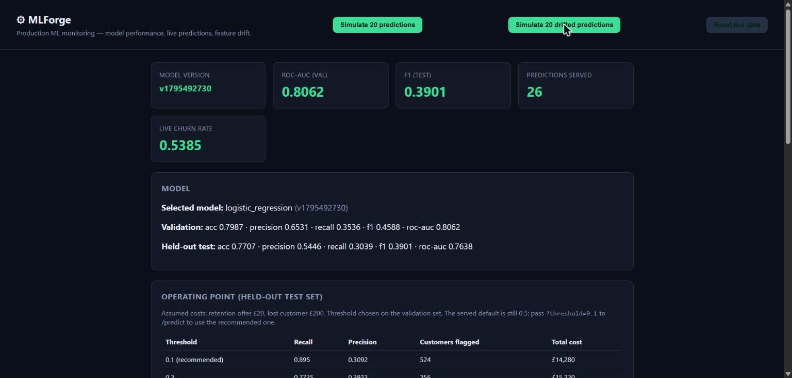
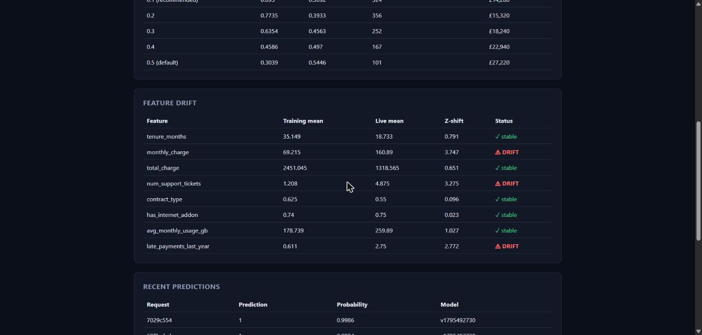

# MLForge

[](https://github.com/Sanchitrana448/mlforge/actions/workflows/ci.yml) [](LICENSE)

Live: https://mlforge-o15e.onrender.com  
*(free tier, so it may take ~50s to wake outside weekday daytime)*

**Try it in one click:** open the live demo and press "Simulate 20 predictions", then "Simulate 20 drifted predictions" to watch the drift flag fire.

Customer churn prediction with the parts that usually get skipped: data validation, model comparison on a proper three-way split, a versioned model registry, a served API, and drift monitoring against the training distribution.

## Screenshots


*Model metrics, live prediction counters and the cost table behind the recommended 0.1 threshold.*


*After "Simulate 20 drifted predictions": `monthly_charge`, `num_support_tickets` and `late_payments_last_year` are flagged as drifted.*

## About the numbers

Latest run, 5,000 rows, seed 42, churn base rate 24.1%:

| | accuracy | precision | recall | F1 | ROC-AUC |
|---|---|---|---|---|---|
| validation | 0.799 | 0.653 | 0.354 | 0.459 | 0.806 |
| held-out test | 0.771 | 0.545 | 0.304 | 0.390 | 0.764 |

The ROC-AUC looks fine. The recall does not, and that's the number that matters here.

At the default 0.5 threshold the model catches about 30% of customers who actually churn. For a retention use case that's close to useless: you'd miss two thirds of the people you were trying to save. The accuracy figure of 0.771 is also doing less work than it appears, since predicting "nobody churns" scores 0.759 on a 24% base rate.

The fix isn't a better model, it's a better threshold. Churn is asymmetric: a retention offer costs maybe £20, a lost customer costs the remaining lifetime value. That ratio should set the operating point, not 0.5. Lowering the threshold trades precision for recall, and with AUC at 0.806 there's real signal available to trade against. The served default is still 0.5, and I wrote the gap down here rather than quietly tuning it, because the gap between "good AUC" and "useful model" is the interesting part.

The fix is now measured. Under an assumed £20 offer and £200 lost customer, a threshold chosen on the validation set (0.1) lifts test recall from 0.30 to 0.90 and cuts total cost by about 48%, at the price of flagging 70% of customers. The full table, and why that last number is a warning rather than a win, is in [RESULTS.md](RESULTS.md). Pass `?threshold=0.1` to `/predict` to use it; `GET /model` returns the `operating_point` block.

## Structure

```
data generation + validation
  -> stratified train/val/test split (70/15/15)
  -> fit logistic regression, random forest, gradient boosting
  -> pick best by validation ROC-AUC
  -> re-evaluate that one on the test set
  -> save to registry (versioned .joblib + metadata JSON + current pointer)
  -> serve
  -> drift check against training feature stats
```

Model selection happens on validation and final numbers come from a test set the selection never touched. Selecting and reporting on the same holdout is the standard way to end up with an optimistic number that doesn't survive contact with production.

## Data

The dataset is synthetic, generated in `app/data.py` from a seeded logistic model over tenure, contract type, monthly charge, support tickets, late payments and usage. Real churn data that's redistributable is hard to come by, and a documented generator means the feature-to-label relationship is known, so model behaviour can be checked against ground truth rather than guessed at.

The tradeoff is honest: no synthetic dataset has the messiness of real data. The pipeline is the artifact here, not the model's absolute score.

## Running it

```bash
pip install -r requirements.txt
uvicorn app.main:app --reload
```

A model trains automatically on first boot if the registry is empty. Dashboard at http://localhost:8000. To train explicitly:

```bash
python -m app.train
```

## API

| Method | Endpoint | Purpose |
|---|---|---|
| `POST` | `/predict` | Single prediction (optional `?threshold=`) |
| `POST` | `/batch-predict` | Batch |
| `POST` | `/train?n_rows=5000` | Retrain and hot-swap the serving model |
| `GET` | `/model` | Full metadata: candidates, metrics, feature stats |
| `GET` | `/metrics` | Live serving metrics |
| `GET` | `/drift` | Per-feature drift vs training distribution |
| `GET` | `/predictions/recent` | Recent prediction log |
| `GET` | `/health` | Liveness and whether a model is loaded |
| `POST` | `/live/reset` | Clear live samples and the prediction log (dashboard demo) |

## Drift detection

`/drift` compares the running mean of each incoming feature against its training mean, expressed in training standard deviations, and flags anything past 2.5. It's a cheap stand-in for PSI: no extra dependency, easy to test, and it catches the failure it's meant to catch, which is a feature distribution walking away from what the model was fit on.

It won't catch a shape change that preserves the mean. A bimodal split around the original mean reads as perfectly stable. Real PSI over binned distributions is the upgrade.

Live samples are capped at the last 2,000 and predictions at the last 500, so memory stays bounded.

## Tests

```bash
pytest tests/ -v
```

Twelve tests: dataset shape and validity, seed reproducibility, validation catching missing columns and an out-of-range target, and drift detection on three cases (matching distributions producing no flag, a large shift producing one, and empty input returning an empty report rather than dividing by zero), plus cost arithmetic for the operating point, thresholds moving the right way as costs change, the threshold override on `/predict`, and drifted traffic being flagged end to end through the API.

## Evaluation

```
python eval/run_eval.py
```

Retrains with seed 42 and writes [RESULTS.md](RESULTS.md): the three-model comparison, held-out test metrics and the operating-point table. CI runs it on every push. The dashboard also has a "Simulate 20 drifted predictions" button so the drift detector can be seen firing.

## Limitations

- No experiment tracking. MLflow or W&B would replace the hand-rolled metadata JSON.
- Retraining is synchronous and blocks the request. Fine at this scale, wrong at any real one.
- The registry is the local filesystem, so on an ephemeral host it resets and retrains on boot.
- The served default threshold is still 0.5. The recommended one is computed and exposed, not applied. The cost model assumes every offer works.
- Hyperparameters are fixed. No search.

## Stack

Python, FastAPI, scikit-learn, pandas, numpy, joblib, Docker, pytest.
